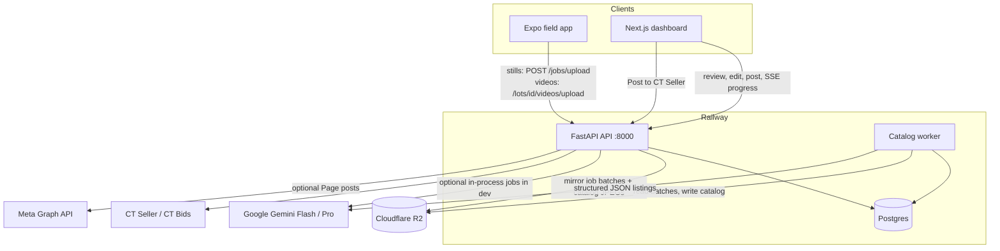

# Estate-EZ

AI-assisted estate-sale cataloging for a [Caring Transitions](https://www.caringtransitions.com/) franchise.

Field staff photograph lots on a phone. Gemini reads SKU tape, brands, condition, and era, then drafts auction titles and descriptions. Staff review the catalog in a web dashboard and post finished lots to **CT Bids** (via CT Seller). Optional Facebook Page posts and collector-group research sit on top of the same inventory.

This repository is the production monorepo: FastAPI API, catalog worker, Next.js dashboard, and Expo field app.

**Live demo:** _add a public walkthrough URL (or Loom) here_

## Screenshots

| Dashboard | Lot editor | Field capture |
| --- | --- | --- |
|  |  |  |

Add the three images under [`docs/screenshots/`](docs/screenshots/README.md). Until then GitHub will show broken-image placeholders.

## Key features

- **Gemini photo intake** — structured JSON listings (brand, model, material, condition, era, SKU) from lot photos. Flash handles triage and listing copy; Pro audits labels when Flash disagrees.
- **Estate-tape SKU reading** — colored tape / paper markers are treated as lot identity, not factory labels. Dedicated tape frames are never used as the website hero.
- **Listing gallery planning** — a cheap Flash pass orders photos for shoppers (group → item chapters → labels → tape). Dashboard **Sort for listing** reapplies the deterministic fallback.
- **CT Seller / CT Bids posting** — dashboard-only publish of title, description, price, condition, and photos (SKU-tape frames omitted). Posted items are not rewritten after a lot is moved between sales.
- **Expo field app** — native camera, short lot videos, offline SQLite queue, and sync that adopts in-flight jobs instead of re-uploading (avoids duplicate lots and a second Gemini bill). Videos are extra media; they are not sent through Gemini or CT Bids.
- **Multi-tenant staff roles** — owner, catalogger, and client-upload logins, JWT sessions, team activity.
- **Facebook Page posting** (optional) — connect a Page, preview, then post or schedule. Nothing publishes until an owner clicks Post/Schedule (auto-approve is off by default). Instagram / Stories / TikTok / Groups publishers are not implemented.
- **Find groups** — Gemini Pro + Google Search for public **US** collector Facebook groups. Stores names/URLs on the lot; does not scrape members or auto-post.
- **Engagement / Push queue** — scores live CT Bids snapshots into a work queue and a planned social calendar.
- **Exports** — Markdown, JSON, CSV, inventory PDF, and hero/photo ZIPs.
- **Object storage** — Cloudflare R2 in production (API and worker share one bucket). Local disk is the dev fallback.

Photo analysis is a no-op without `GOOGLE_API_KEY`. Auth, sales, lots, and exports still run.

## Tech stack

| Layer | Stack |
| --- | --- |
| API | Python 3.12, FastAPI, SQLAlchemy 2, Alembic, Pydantic Settings, `google-genai` |
| Worker | same image as the API (`python -m app.worker`) |
| Web | Next.js 15, React 18, TypeScript |
| Mobile | Expo SDK 54, React Native, expo-camera, expo-sqlite, EAS Update |
| Data | Postgres in production, SQLite in development |
| Media | Cloudflare R2 (S3 API), Pillow / pillow-heif, rembg for plain backgrounds |
| Auth | JWT (`python-jose`) + bcrypt; Meta OAuth when Facebook posting is enabled |
| Hosting | Docker on Railway (`infra/docker/Dockerfile.{api,web,worker}`) |

## Architecture



**Production split.** The API, worker, and web app are separate Railway services with ephemeral disks. Set `RUN_CATALOG_JOBS_IN_PROCESS=false` on the API so Gemini runs only on the worker. Dashboard progress is stored in Postgres (`job_sse_events`) because in-memory pub/sub cannot cross processes.

**Local default.** The API runs catalog jobs in-process. The worker process is optional.

Repo-root `main.py` is a **legacy desktop CLI scanner**, not the API. The FastAPI app is `app.main:app` and must be started from `backend/`.

## Setup

### Prerequisites

- Python 3.12+
- Node.js 20+
- A [Google AI Studio](https://aistudio.google.com/apikey) key for cataloging (optional for auth/CRUD)

Postgres is **not** required locally. The API creates SQLite tables on startup (`backend/app.db`). Alembic is optional in development.

### 1. Backend API

```bash
cd backend
python -m venv .venv
source .venv/bin/activate          # Windows: .venv\Scripts\activate
pip install -r ../requirements.txt
cp .env.example .env
# Set SECRET_KEY (openssl rand -hex 32) and GOOGLE_API_KEY
```

`SECRET_KEY` must be at least 32 characters and must not be `change-me`. `ENVIRONMENT=development` keeps SQLite allowed.

```bash
# from backend/
.venv/bin/uvicorn app.main:app --reload --port 8000
```

Health check: [http://localhost:8000/health](http://localhost:8000/health).

Optional worker (only if you set `RUN_CATALOG_JOBS_IN_PROCESS=false`):

```bash
# from backend/
.venv/bin/python -m app.worker
```

### 2. Web dashboard

```bash
cd frontend
cp .env.example .env.local         # NEXT_PUBLIC_API_BASE=http://localhost:8000
npm install
npm run dev
```

Open [http://localhost:3000](http://localhost:3000). Register a first account (`ALLOW_OPEN_REGISTRATION` defaults to open in development).

### 3. Mobile (optional)

Needs a device or emulator and Expo Go. Not runnable headless.

```bash
cd mobile
cp .env.example .env
# Point EXPO_PUBLIC_API_BASE at the same API the web app uses
npm install
npx expo start
```

EAS / TestFlight notes: [`mobile/README.md`](mobile/README.md).

### Tests

```bash
cd backend
../backend/.venv/bin/python -m pytest
```

No frontend lint/test script is configured. `npm run build` in `frontend/` is the production compile check.

## Environment variables

Copy the examples; never commit a real `.env`.

| File | Used by |
| --- | --- |
| [`backend/.env.example`](backend/.env.example) | API + worker (canonical list) |
| [`frontend/.env.example`](frontend/.env.example) | Next.js (`NEXT_PUBLIC_*` baked in at start/build) |
| [`mobile/.env.example`](mobile/.env.example) | Expo Go / local API |
| [`.env.example`](.env.example) | Legacy `main.py` CLI only |

Required to boot the API in development:

| Variable | Purpose |
| --- | --- |
| `SECRET_KEY` | JWT signing; ≥32 random chars |
| `DATABASE_URL` | SQLite default `sqlite:///./app.db`; Postgres in production |
| `ENVIRONMENT` | `development` locally; `production` on Railway |

Common optional variables:

| Variable | Purpose |
| --- | --- |
| `GOOGLE_API_KEY` | Gemini cataloging, regenerate, audience hunt |
| `CORS_ORIGINS` | Production web origin (required when `ENVIRONMENT=production`) |
| `R2_ACCESS_KEY_ID` / `R2_SECRET_ACCESS_KEY` / `R2_BUCKET` / `R2_ENDPOINT` | Durable photos + job batches |
| `RUN_CATALOG_JOBS_IN_PROCESS` | `false` on the production API |
| `META_APP_ID` / `META_APP_SECRET` | Facebook Page connect/post |
| `FEEDBACK_TO_EMAIL` + `SMTP_*` | Dashboard suggestion inbox |
| `NEXT_PUBLIC_API_BASE` | Public API URL for the web client |
| `EXPO_PUBLIC_API_BASE` | API URL for the phone app |

Production deploy, R2 CORS, worker memory caps, and Facebook app setup: [`DEPLOY.md`](DEPLOY.md).

## Security notes

- `.env`, `*.db`, `backend/data/`, `listings/`, and estate `Images/` are gitignored.
- Production refuses a weak `SECRET_KEY`, SQLite, and empty `CORS_ORIGINS`.
- Registration is closed in production unless `ALLOW_OPEN_REGISTRATION=true` (bootstrap only).
- CT Seller passwords and Facebook Page tokens are stored per account (tokens encrypted at rest), not in env files.

If this repo was ever cloned while a real key lived on disk, rotate Gemini, R2, Meta, SMTP, Expo, and JWT `SECRET_KEY` from the host dashboard. Git history was not rewritten.

## Project layout

```
backend/          FastAPI app, worker, Alembic, pytest
frontend/         Next.js dashboard
mobile/           Expo field capture
infra/docker/     API, web, and worker images
main.py           Legacy local Gemini scanner (not the SaaS API)
DEPLOY.md         Railway / R2 / Facebook production notes
```

## License

Private application code for a Caring Transitions franchise. Ask the owner before reusing listing copy, client photos, or CT Seller credentials.
